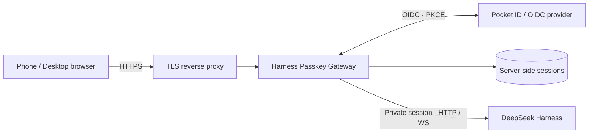

# Harness Passkey Gateway

**Your agent workspace. Your devices. Your passkeys.**

[中文](readme_zh.md) · [Architecture](docs/architecture.md) · [Deploy](docs/deployment.md) · [Security](SECURITY.md)

A small, self-hosted access gateway for **DeepSeek Harness**. Sign in with a passkey through an OpenID Connect provider such as **Pocket ID**, then use the Harness browser interface without exposing its process launch token.

> Early implementation. Deployment templates are provided; device enrollment and end-to-end authentication require operator validation. This project is independent of DeepSeek, Pocket ID, Cloudflare, and frp.

## Goals

- **Passkeys across devices:** independent credentials for phones, Windows, and macOS.
- **Persistent, revocable sessions:** server-side state, a 90-day absolute ceiling, and a 7-day inactivity limit.
- **Private Harness authentication:** exchange its launch token on the server; keep the upstream cookie out of browser responses.
- **Agent-friendly transport:** preserve streaming responses and authenticated WebSocket upgrades.
- **Self-hosted ingress:** HTTPS through a reverse proxy, optionally carried by an frp TCP tunnel.
- **Portable configuration:** examples use reserved domains and contain no deployment credentials.

## Architecture

Passkey enrollment and cryptographic verification belong to the identity provider. This project implements the OIDC relying party, browser sessions, and the Harness authentication bridge.

## Get started

Read the [deployment guide](docs/deployment.md) for isolated service accounts, OIDC provisioning, restricted launch-credential sharing, HTTPS ingress, and device enrollment. The supplied [systemd templates](deploy/) keep identity, session state, TLS keys, and the agent under separate Unix users.

## Device support

Use a current browser with WebAuthn support. Windows and macOS can use supported platform authenticators or password managers. HarmonyOS requires checking the actual browser: operating-system FIDO2 support alone does not establish browser compatibility. Enrollment requires a person to complete the device's local verification.

## Configuration and disclosure

Production domains, certificates, API keys, OIDC client secrets, launch tokens, screenshots, session databases, and infrastructure inventories **must stay outside this repository**. Read [SECURITY.md](SECURITY.md) before publishing deployment changes.

## Upstream projects

- [DeepSeek Harness](https://github.com/deepseek-ai/deepseek-harness)
- [Pocket ID](https://github.com/pocket-id/pocket-id)
- [openid-client](https://github.com/panva/openid-client)
- [Caddy](https://caddyserver.com/)
- [frp](https://github.com/fatedier/frp)

## License

[MIT](LICENSE). Upstream projects retain their respective licenses and trademarks.
